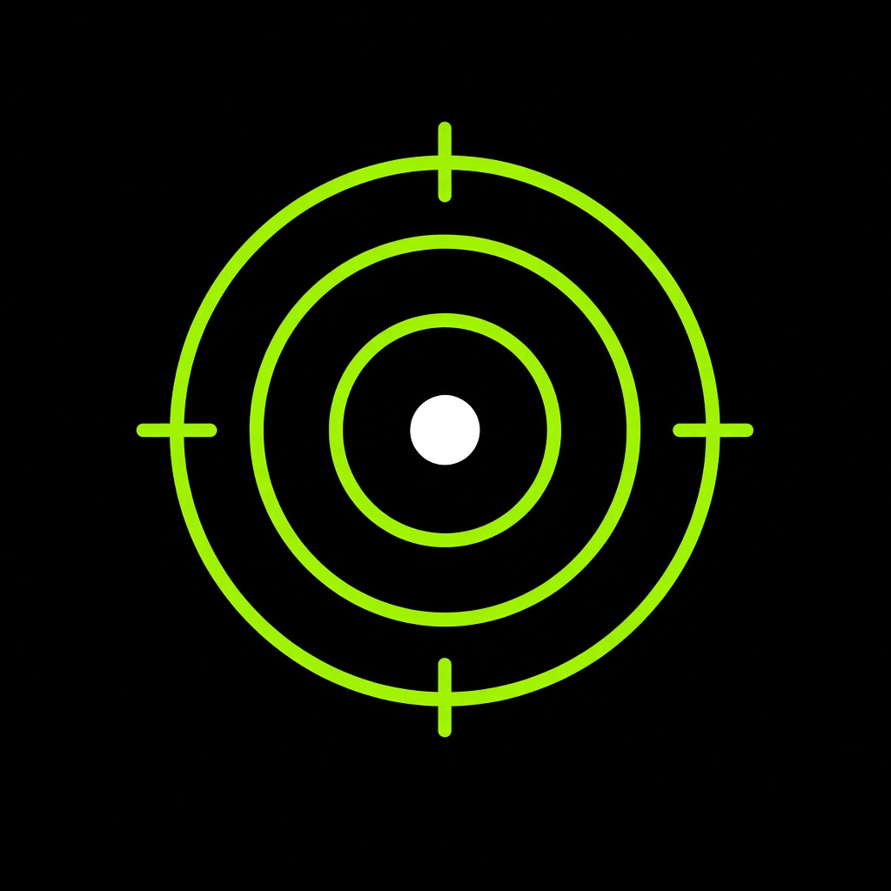

  

# Chrono app

Android companion app for **HT-X3006 / HT-50** Wi‑Fi chronographs.

Based on [ChronoMate](https://github.com/Rec0iL/ChronoMate), simplified for field use: live velocity, energy from the chronograph’s projectile weight, shot history, and PDF export.

## Features

- Connects to the chronograph Wi‑Fi hotspot and reads live shot data
- Uses projectile weight from the device (no manual weight entry in the app)
- Dashboard with latest shot, energy, stats, and velocity chart
- History and PDF session export
- Optional calibration against a second chronograph
- Dark / light theme and keep-screen-on

## Install

Download the APK from **Releases** and install it on the phone. Allow installation from this file if Android asks.

## Connect the chronograph

1. Turn on Wi‑Fi on the HT-X3006 (hold the down button until Wi‑Fi is on).
2. On the phone, join hotspot **HT-X3000**, password `88888888`.
3. Open **Chrono app** and tap the connection badge if it is not already live.

## Build

The project uses the same Android SDK/JDK layout as the other local apps (`compileSdk 34`, Gradle 8.7). Open the folder in Android Studio or run `gradle assembleDebug`.
